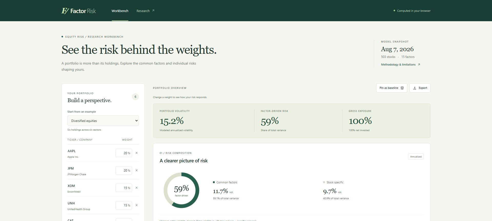

# Factor Risk Workbench

A browser interface for the public 503-stock, 15-factor research model. Build a
portfolio, inspect why its risk differs from its capital allocation, and compare
changes against a pinned baseline. The UI identifies the model snapshot and its
limitations throughout; it does not imply live prices or investment performance.



## Run and build

Requires Node.js 22.12+ (or 20.19+).

```sh
npm ci
npm run dev
npm test
npm run build
npm run preview
```

Copy the contents of `dist/` to a static host. Vite uses relative asset paths,
so the same build works at `/workbench/`, `/demos/factor-risk/`, or a GitHub Pages
repository subpath. Open the site through HTTP, not by double-clicking the HTML.
There are no runtime services, API keys, external fonts, analytics, or model downloads.
After the initial static assets load, editing and analysis require no network calls.

## What works

- Editable holdings with ticker lookup across the model universe; three example portfolios.
- Long, short, cash and leveraged portfolios with explicit net/gross exposure.
- Annualized portfolio volatility; common-factor and specific variance attribution.
- Signed Euler factor contributions, four style exposures, and total holding contributions.
- A pinned baseline with changes in percentage points, using the same model snapshot.
- CSV import of up to 50 holdings, complete JSON analysis export, and per-holding CSV export.
- Versioned local browser persistence, input validation, zero-exposure and model-loading states.
- Responsive layout, keyboard-operable controls, a native accessible methodology dialog,
  reduced-motion support, and labels/text alternatives for charts.

## Calculation semantics

`src/risk.ts` evaluates the same formulas as `RiskModel.decompose`:

```text
b = Bᵀw
factor variance = bᵀFb
specific variance = Σᵢ wᵢ²Dᵢ
volatility = √(factor variance + specific variance)
factor contribution k = bₖ(Fb)ₖ / total variance
total holding contribution i = wᵢ[Bᵢ(Fb) + wᵢDᵢ] / total variance
```

Covariance and specific variance are already annualized in the saved model.
Weights are fractions of NAV internally and percentages in the editor. They are
**never normalized**. Negative weights are shorts; weights below 100% leave a
zero-risk cash balance, and a net weight above 100% implies financing. Cash yield,
financing costs and margin are not modeled. Factor and asset contributions may be
negative, and are retained rather than clipped. Volatilities do not sum; variances do.

Unknown symbols, duplicates, nonfinite/incomplete weights and individual weights
outside ±1,000% are rejected visibly. The workbench intentionally does not use the
Python library's silent unknown-symbol dropping behavior. Zero invested exposure
has zero modeled risk and zero attribution shares instead of undefined ratios.

## Data provenance and reproducibility

`public/model.json` contains only the already-public model snapshot and company
labels. `scripts/export_model.py` reads:

- `BinaryClassification/model/{exposures,factor_cov,specific_var,sectors}.csv`
- `BinaryClassification/model/meta.json`
- `BinaryClassification/sp500.csv`

The export carries SHA-256 hashes of the model artifacts. It excludes raw Databento
files, pickles, returns histories, private portfolios and forecasting checkpoints.
To rebuild the export and independent Python reference fixtures:

```sh
python -m pip install numpy pandas
npm run data
```

The snapshot is dated **2026-08-07**, with 1,937 daily observations from
2018-11-20 through 2026-08-07. It uses current S&P 500 membership through history,
unadjusted prices with large split jumps masked, and dollar volume as a size proxy.
It is a research model, not a live risk feed. See the repository's original research
and limitations for the underlying estimation method.

## Verification

The Vitest suite checks five Python-generated parity portfolios (diversified,
concentrated, long/short, single-stock, leveraged) to 12 decimal places. It also
checks contribution additivity, scaling, signed hedges, empty portfolios, malformed
inputs, import/export units and malformed model data. `npm run build` includes strict
TypeScript checking. The existing Python research tests run from the repository root
with `python -m pytest -q`.

Browser QA covered changing weights, baseline deltas, invalid-input recovery, the
methodology dialog, responsive charts and overflow at a 390-pixel viewport. These
checks exercise the local workbench; publication and live-host verification are
separate steps.
